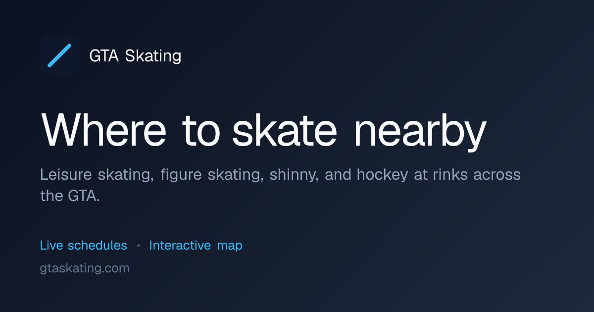

# GTA Skating

<div align="center">



[](https://gtaskating.com)
[](https://github.com/dodaydream/gta-skating/stargazers)

</div>

Find public skating, figure skating, shinny, and hockey drop-in schedules at
rinks across the Greater Toronto Area — on an interactive map, with date and
program filters, favourites, and crowd ("busyness") reports.

The site is a fully static [Next.js](https://nextjs.org) app (App Router, static
export) deployed to GitHub Pages at [gtaskating.com](https://gtaskating.com).

## Features

- **Interactive map** — MapLibre GL map of every covered arena, with light and
  dark basemaps that follow the in-app theme toggle.
- **Day and week schedules** — each venue opens a drawer with a day list and a
  week grid.
- **Filters** — filter by date range and program type; sort by soonest or
  nearest.
- **Favourites** — saved in the browser, with a favourites-only map view.
- **Busyness reports** — anonymous "how busy is it" ratings, averaged once a
  session has enough reports (optional; requires Firebase).
- **Bilingual UI** — English and French.

## Tech stack

- Next.js 16 (App Router, `output: "export"`), React 19, TypeScript
- Tailwind CSS v4 and shadcn/ui components
- MapLibre GL JS with [OpenFreeMap](https://openfreemap.org) styles
- i18next / react-i18next for internationalization
- Firebase (Auth + Firestore) for anonymous busyness reports
- dayjs for timezone-aware schedule handling

## Getting started

```bash
yarn install
yarn dev
```

Open [http://localhost:3000](http://localhost:3000) in your browser.

## Scripts

| Script             | Description                                             |
| ------------------ | ------------------------------------------------------- |
| `yarn dev`         | Start the development server.                           |
| `yarn build`       | Production build to `out/`.                             |
| `yarn start`       | Serve the built `out/` directory locally.               |
| `yarn lint`        | Run ESLint.                                             |
| `yarn scrape`      | Run every venue scraper, then rebuild the client data.  |
| `yarn build:data`  | Rebuild client data from `out/scraped-data` only.       |
| `yarn scrape:check` | Type-check the project (`tsc --noEmit`).                |
| `yarn test:e2e`    | Run the Playwright end-to-end tests.                    |
| `yarn test:e2e:ui` | Run Playwright in UI mode.                              |

## Project structure

```
src/
  app/          # routes: /, /venue/[slug], /data-sources, /faq, /privacy, sitemap, robots
  api/          # client-side data loading (venue details, program shards, busyness)
  components/   # UI: map, schedule, filters, ads, seo, ui (shadcn), and app shell
  data/         # schedules.ts, venue-meta.ts and generated/venue-meta.json
  i18n/         # en.ts / fr.ts message catalogues
  lib/          # theme, favourites, analytics, feedback, firebase, schedule helpers
  types/        # shared TypeScript types
scraper/        # one folder per source, each with a scrape.ts entry
  index.ts            # runs every scraper, then build-client-data
  build-client-data.ts
```

### Routes

- `/` — map plus the schedule sidebar.
- `/venue/[slug]` — one statically generated page per venue.
- `/data-sources` — where the data comes from, plus licensing and attribution.
- `/faq` — frequently asked questions.
- `/privacy` — privacy policy.

## Data pipeline

Each scraper under `scraper/<source>/` writes a JSON file per venue to
`out/scraped-data/` (git-ignored). `scraper/build-client-data.ts` then derives
the committed, client-facing artifacts:

```
scraper/<source>/scrape.ts  ──▶  out/scraped-data/<slug>.json
        │                                  │
        └──────────── yarn scrape ─────────┘
                          │
                          ▼
                 build-client-data.ts
        ┌─────────────────┴──────────────────┐
        ▼                                     ▼
src/data/generated/venue-meta.json   public/data/programs-YYYY-MM.json
(venue facts + stable ids, baked     (programs sharded by month,
 into the bundle)                     fetched on demand)
```

Venue metadata is baked into the client bundle so slug and coordinate lookups
are synchronous; program shards are fetched on demand for the months a query
touches and joined to that metadata after loading. A venue whose scraper fails
is retained from the previously committed artifacts, so one broken scraper never
drops a venue.

## Data sources and licensing

Schedules are aggregated from the public pages and open data feeds published by
municipal recreation departments, arena operators, and universities. The full
list, along with licensing and attribution, is on the `/data-sources` page.

City of Toronto schedules come from the City of Toronto Open Data
"Registered Programs and Drop In Courses Offering" dataset, used under the
[Open Government Licence – Toronto](https://www.toronto.ca/city-government/data-research-maps/open-data/open-data-licence/).

## Environment variables

Set these as repository **Variables** (Settings → Secrets and variables →
Actions → Variables) for deployments, or in `.env.local` for local builds.

| Variable                     | Purpose                                                            |
| ---------------------------- | ------------------------------------------------------------------ |
| `NEXT_PUBLIC_GA_ID`          | Google Analytics 4 measurement ID; unset disables analytics.       |
| `NEXT_PUBLIC_ADSENSE_CLIENT` | AdSense publisher ID; unset disables the AdSense script.           |
| `NEXT_PUBLIC_ADSENSE_SLOT`   | AdSense ad unit slot ID for the manual unit; unset hides the unit. |
| `NEXT_PUBLIC_BUYMEACOFFEE_URL` | Optional support link shown in the footer.                       |
| `NEXT_PUBLIC_BASE_PATH`      | Optional base path; unset for the custom-domain root deployment.   |

Only a single manual ad unit is rendered; keep **Auto ads** off in the AdSense
dashboard so no extra ads are injected.

### Busyness reports (optional)

Busyness reports are disabled unless Firebase is configured. Provide the
following to enable them:

- `NEXT_PUBLIC_FIREBASE_API_KEY`
- `NEXT_PUBLIC_FIREBASE_AUTH_DOMAIN`
- `NEXT_PUBLIC_FIREBASE_PROJECT_ID`
- `NEXT_PUBLIC_FIREBASE_STORAGE_BUCKET`
- `NEXT_PUBLIC_FIREBASE_MESSAGING_SENDER_ID`
- `NEXT_PUBLIC_FIREBASE_APP_ID`

## Deploy on GitHub Pages

The app builds to a fully static site (`output: "export"`) and is deployed by
`.github/workflows/deploy.yml`: the `build` job runs `next build` and uploads
`out/`, and the `deploy` job publishes it with `actions/deploy-pages`.

The site is served from the custom domain `gtaskating.com` at the site root, so
no base path is configured. Enable Pages once under Settings → Pages → Source →
**GitHub Actions**.

Schedules are refreshed weekly by `.github/workflows/scrape.yml`, which commits
the regenerated artifacts in `src/data/generated/` and `public/data/`, then
dispatches the deploy workflow.

To preview the production build locally:

```bash
yarn build
yarn start
```

## Contributing

Spotted a wrong schedule or an arena we're missing? Open an issue on the project
repository at [github.com/dodaydream/gta-skating](https://github.com/dodaydream/gta-skating),
including the arena and, if possible, a link to the correct schedule.
